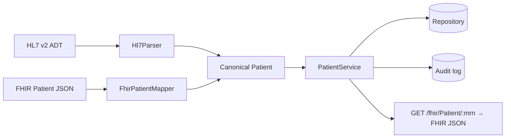

# hl7-fhir-integration

> A **C# / ASP.NET Core** healthcare integration service: ingest patient data as
> **HL7 v2** ADT messages *or* **FHIR** Patient resources, normalize both onto
> one canonical model, serve it back as FHIR, and protect PHI with **role-based
> access control and an audit trail**.


> ℹ️ An **original reference implementation**. No proprietary code, data, or
> real PHI is included — all sample data is synthetic.

---

## What it does

Hospitals speak **HL7 v2** (pipe-delimited ADT messages) and **FHIR** (JSON
resources). This service accepts both, maps each onto a single canonical
`Patient`, and exposes a FHIR read API — so downstream systems integrate once.



- **HL7 v2 parse** — reads MSH/PID segments (identifier, name, birth date,
  administrative sex) from an ADT message.
- **FHIR mapping** — converts between the canonical model and a FHIR R4 Patient,
  translating HL7 sex codes ↔ FHIR gender.
- **PHI protection** — a pure role-based policy (`clinician`, `admin`) gates every
  endpoint, and **every PHI touch writes an audit event** (who, what, which MRN).

## API

| Method | Path | Permission | Purpose |
| --- | --- | --- | --- |
| `POST` | `/api/hl7` | `patient:write` | Ingest an HL7 v2 ADT message (text) |
| `POST` | `/fhir/Patient` | `patient:write` | Ingest a FHIR Patient (JSON) |
| `GET`  | `/fhir/Patient/{mrn}` | `patient:read` | Read a patient as FHIR |
| `GET`  | `/api/audit` | `audit:read` | Read the audit trail (admin) |

Role is supplied via the `X-Role` header; missing → `401`, insufficient → `403`.

```bash
curl -XPOST localhost:8080/api/hl7 -H "X-Role: clinician" -H "X-Actor: nurse1" \
  --data-binary $'MSH|^~\\&|S|F|R|F|20260101||ADT^A01|M1|P|2.5\rPID|1||MRN12345^^^FAC^MR||Doe^John||19800101|M'
curl localhost:8080/fhir/Patient/MRN12345 -H "X-Role: clinician"
```

---

## Build & test

```bash
dotnet test
```
Covers HL7 parsing (valid + malformed messages), FHIR mapping (round-trip +
rejections), the ingest/read service with audit logging, and the RBAC policy
(allowed / forbidden / unauthenticated) — all as fast, host-free unit tests.

Run the service: `dotnet run --project src/Hl7FhirIntegration` (or `docker build`).

---

## Design decisions

- **One canonical model, two wire formats** — HL7 and FHIR are adapters at the
  edge; the core never sees either format.
- **Authorization is a pure function** — the policy is unit-tested directly and
  applied by a thin endpoint filter, not tangled into handlers.
- **Audit on every PHI access** — minimum-necessary access is observable and
  reviewable, in line with HIPAA expectations.

---

*An original reference implementation. No proprietary code, data, or real PHI is included.*
